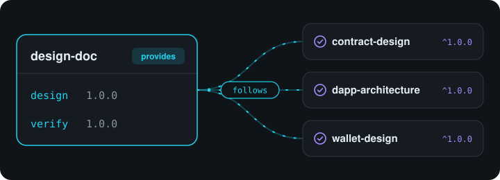

<p align="center">
  
</p>

<h1 align="center">musubi</h1>

<p align="center">スキルが提供するコンテンツとそれに準拠するスキルを結ぶ</p>

<p align="center">
  <a href="https://www.npmjs.com/package/musubi-cli"></a>
  <a href="LICENSE"></a>
  <a href="https://www.npmjs.com/package/musubi-cli"></a>
</p>

<p align="center">
  <a href="https://musubi.cardene.dev/ja/">サイト</a> · <a href="spec/musubi.ja.md">定義</a> · <a href="README.md">English</a>
</p>

<p align="center">
  
</p>

musubiは、あるエージェントのスキルのコンテンツを、別のスキルと結び付けるための提案です。

エージェントのスキルのパッケージマネージャーは既にあり、スキルを依存するスキルと一緒にインストールして、バージョンを固定できます。
ただし、スキルが依存先のどの部分に準拠するのかは記録しません。
その部分とは、書く文書の書式や、守る書き方のルールや、実行するチェックのことです。
musubiでは、スキルが提供するコンテンツを名前とバージョン付きで宣言し、別のスキルがそのコンテンツに準拠すると宣言します。

スキルを実行する時は、エージェントがそのコンテンツを読み込みます。
この動きは、`SKILL.md`を読むどのエージェントでも同じです。
提供するコンテンツが変わると、準拠するスキルが再チェックされます。

定義は[spec/musubi.ja.md](spec/musubi.ja.md)にあります。

## スキルが参加する方法

スキルは`SKILL.md`をそのまま持ち、その隣に`musubi.json`を追加します。
providerは、提供するコンテンツを並べます。

```json
{
  "musubi": "2026-11-19",
  "provides": {
    "design": { "version": "1.0.0", "file": "formats/design.md", "check": "checks/design.json" }
  }
}
```

consumerは、準拠するコンテンツと、受け入れるバージョンと、最後にチェックしたコンテンツのフィンガープリントを並べます。

```json
{
  "musubi": "2026-11-19",
  "follows": {
    "design-doc/design": {
      "version": "^1.0.0",
      "integrity": "sha256-yNSwpBT+xXEV5bGBqedpHmjWIHVi+JaAnRATAJ0s7wM=",
      "examples": ["examples/orders-api.md"]
    }
  }
}
```

consumerの`SKILL.md`の本文は、`design-doc`のスキルを名前で開いて`design`の書式を読むよう、エージェントに伝えます。
そのため、エージェントは新しい仕組みがなくてもコンテンツを読み込めます。
providerが無くても動くconsumerは、定義のバージョン`2026-11-20`を書き、準拠に`"optional": true`を足します。
するとエージェントは、providerがインストールされていない時にそのコンテンツ無しで作業を続けます。
定義のバージョン`2026-11-21`では、さらに`"when": { "languages": ["ja"] }`を足せます。
足すと、`musubi install --lang ja`がconsumerと一緒にproviderもインストールします。
2つのスキルは[examples/skills](examples/skills)にあります。

## チェック

`musubi`コマンドは宣言をチェックし、providerのチェックをconsumerの例に適用します。
Node.js 22.18以降で動き、実行時の依存を持ちません。
npmに`musubi-cli`として公開しており、インストールした後はプロジェクトのフォルダで実行します。

```bash
npm install -g musubi-cli
musubi check
musubi graph --out graph.html
```

フォルダを指定しない時、`musubi check`はカレントフォルダとホームフォルダにある`.claude/skills`、`.agents/skills`、`.github/skills`、`.gemini/skills`を読みます。
インストールせずに1回だけ実行する時は、`npx musubi-cli check <スキルのフォルダ>`を使います。

このリポジトリをクローンして実行する時は、先に開発用の依存をインストールします。

```bash
pnpm install
node src/cli.ts check examples/skills
node src/cli.ts graph examples/skills --out graph.html
```

## 準拠するスキルと一緒にインストールする

`musubi install`は、スキルと、その`musubi.json`が準拠するスキルを、`--from`で名指したフォルダかgitのリポジトリからまとめてインストールします。

```bash
musubi install convey --from https://github.com/example/skills --to .claude/skills --lang ja
```

インストール元の中からフォルダ名でスキルを探し、そのフォルダを`--to`へコピーします。
`--to`が無い時は、カレントフォルダの`.claude/skills`、`.agents/skills`、`.github/skills`、`.gemini/skills`のうち最初に在るフォルダを使います。
必須の準拠のproviderは必ずインストールします。
任意の準拠のproviderは、`--with <スキル名>`で名指した時か、準拠が`when`に利用者の言語を書いていて、その言語を`--lang`で渡した時にインストールします。
インストール済みのスキルはそのまま残し、最後に`musubi check`を実行します。

## サイトにスキルを載せる

musubiのサイトは、定義と、GitHubで見つけたスキルを表示します。
スキルごとに、提供するコンテンツと、準拠するコンテンツと、そのスキルに準拠しているスキルが載ります。
スキルを載せる時は、スキルを置いた公開リポジトリに、GitHubのリポジトリの画面のAboutの設定でトピック`musubi-skills`を付けます。
PRは要りません。

サイトは更新するたびに、トピック`musubi-skills`を持つ公開リポジトリをGitHubで検索し、デフォルトブランチで`musubi.json`と`SKILL.md`が並ぶフォルダを全て載せます。
`musubi check`と同じチェックに通らない`musubi.json`を持つフォルダは、サイトをビルドする時にフォルダ名と理由を表示し、一覧から外します。

管理者のスキルは、リポジトリごとに`registry/<owner>/<repo>.json`というファイルにも置き、載せるフォルダをリポジトリのルートからの相対パスで並べます。

```json
{
  "skills": ["plugins/doc-formats/skills/design-doc", "plugins/evm-dev/skills/contract-design"]
}
```

`registry/excluded.json`には、サイトに載せない物を書きます。
リポジトリ全体は`<owner>/<repo>`、1つのフォルダは`<owner>/<repo>/<folder>`の形で並べます。

```json
{
  "excluded": ["someone/repo", "someone/other-repo/skills/old-skill"]
}
```

サイトをビルドして手元の<http://localhost:3810/>で開く時は、`gh auth login`でログインしてから`pnpm site`を実行します。
このコマンドは`node site/build.ts`で、ログインしたghを使ってGitHubを検索し、ページを`site/dist/`に書き出してから、そのフォルダを配信します。
公開したサイトは<https://musubi.cardene.dev/>にあり、`pnpm site:publish`で公開する手順は[docs/publishing.ja.md](docs/publishing.ja.md)にあります。

## 文書

| 文書 | 内容 |
|---|---|
| [spec/musubi.ja.md](spec/musubi.ja.md) | 定義 |
| [GLOSSARY.ja.md](GLOSSARY.ja.md) | 定義が使う用語 |
| [docs/publishing.ja.md](docs/publishing.ja.md) | サイトをGitHub Pagesへ公開する手順 |
| [docs/adr](docs/adr) | 元に戻すのが高くつく判断と、採らなかった案 |

## ライセンス

musubiはMITライセンスで公開しています。
全文は[LICENSE](LICENSE)にあります。
