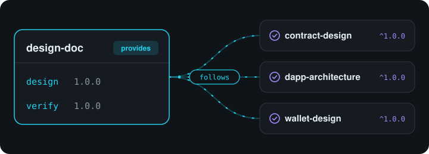

<p align="center">
  
</p>

<h1 align="center">musubi</h1>

<p align="center">Bind what one skill provides to the skills that follow it</p>

<p align="center">
  <a href="https://www.npmjs.com/package/musubi-cli"></a>
  <a href="LICENSE"></a>
  <a href="https://www.npmjs.com/package/musubi-cli"></a>
</p>

<p align="center">
  <a href="https://musubi.cardene.dev/">Website</a> · <a href="spec/musubi.md">Definition</a> · <a href="README.ja.md">日本語</a>
</p>

<p align="center">
  
</p>

musubi is a proposal for binding the content of one agent skill to another.

Package managers for agent skills already install a skill together with the skills it depends on and lock their versions.
What they do not record is which part of a dependency a skill follows: the document format it writes in, the writing rules it obeys, or the check it runs.
musubi lets a skill declare the content it provides under a name and a version, lets another skill declare that it follows that content, and lets an agent load the content when the skill runs, the same way in every agent that reads `SKILL.md`.
When the provided content changes, the skills that follow it are checked again.

The definition is in [spec/musubi.md](spec/musubi.md).

## How a skill takes part

A skill keeps its `SKILL.md` as it is and adds `musubi.json` next to it.
A provider lists the content it offers.

```json
{
  "musubi": "2026-11-19",
  "provides": {
    "design": { "version": "1.0.0", "file": "formats/design.md", "check": "checks/design.json" }
  }
}
```

A consumer lists the content it follows, the versions it accepts, and the fingerprint of the content it last checked.

```json
{
  "musubi": "2026-11-19",
  "follows": {
    "design-doc/design": {
      "version": "^1.0.0",
      "integrity": "sha256-yNSwpBT+xXEV5bGBqedpHmjWIHVi+JaAnRATAJ0s7wM=",
      "examples": ["examples/orders-api.md"]
    }
  }
}
```

The consumer's `SKILL.md` body tells the agent to open the `design-doc` skill by name and read its `design` format, so agents need nothing new to load it.
[examples/skills](examples/skills) holds both skills.

## Checking

The `musubi` command checks the declarations and applies each provider's check to the consumers' examples.
It needs Node.js 22.18 or later and has no runtime dependencies.
It is published on npm as `musubi-cli`; once installed, run it in a project folder.

```bash
npm install -g musubi-cli
musubi check
musubi graph --out graph.html
```

Without folders, `musubi check` reads `.claude/skills`, `.agents/skills`, `.github/skills`, and `.gemini/skills` in the current folder and in the home folder.
To run it once without installing, use `npx musubi-cli check <skills folder>`.

To run it from a clone of this repository, install the development dependencies first.

```bash
pnpm install
node src/cli.ts check examples/skills
node src/cli.ts graph examples/skills --out graph.html
```

## Listing a skill on the site

The musubi site shows the definition and the skills it finds on GitHub, with what each one provides, what it follows, and which skills follow it.
To list your skills, give their public repository the topic `musubi-skills` in the About settings of the repository page on GitHub.
No pull request is needed.

Each time the site is updated, it searches GitHub for public repositories with the topic `musubi-skills` and lists every folder on the default branch that holds both `musubi.json` and `SKILL.md`.
A folder whose `musubi.json` fails the checks `musubi check` runs is named with the reason when the site is built, and left out.

The maintainers' own skills are also named in `registry/<owner>/<repo>.json`, one file per repository, which lists the skill folders relative to the repository root.

```json
{
  "skills": ["plugins/doc-formats/skills/design-doc", "plugins/evm-dev/skills/contract-design"]
}
```

`registry/excluded.json` names what the site leaves out: a whole repository as `<owner>/<repo>`, or one folder as `<owner>/<repo>/<folder>`.

```json
{
  "excluded": ["someone/repo", "someone/other-repo/skills/old-skill"]
}
```

To build the site and open it on your machine at <http://localhost:3810/>, sign in with `gh auth login` and run `pnpm site`.
It runs `node site/build.ts`, which searches GitHub with your gh sign-in, writes the pages to `site/dist/`, and then serves that folder.
The public site is at <https://musubi.cardene.dev/>, and [docs/publishing.md](docs/publishing.md) explains how to publish it with `pnpm site:publish`.

## Documents

| Document | Holds |
|---|---|
| [spec/musubi.md](spec/musubi.md) | The definition |
| [GLOSSARY.md](GLOSSARY.md) | The terms the definition uses |
| [docs/publishing.md](docs/publishing.md) | How the site is published to GitHub Pages |
| [docs/adr](docs/adr) | Decisions that are costly to reverse, with the options not taken |

## License

musubi is released under the MIT License. The full text is in [LICENSE](LICENSE).
